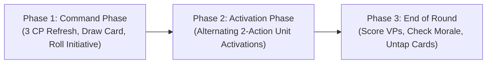

# 4192 AD: THE COMPLETE CORE RULES MANUAL (v4.2)
> **v4.2 changes (2026-10-17):**
> - CP refresh + underdog CP; Tactical hand of 3; initiative to the side that finished first; catch-up Pass.
> - **FIGHT once per activation**.
> - Suppression (Rattled / Pinned); new keywords [FRAIL] [EXPENDABLE] [SUPPRESSIVE] [HARPOON] [SYNAPSE].
> - Game sizes, Muster rules, pre-game sequence, rules vocabulary (Sections 7–9).
>
> Rationale and simulator evidence: `GAME_SYSTEM_PLAN.md`, `GEMINI_PLAN_REVIEW.md`.
*A Model-Agnostic, Hyper-Tactical Skirmish Engine — Zero Corporate Bloat. Zero Downtime. Pure Tabletop Warfare.*

---

## SECTION 1: CORE CONCEPTS, STATS & BASE CLASSES

### 1.1 The 6-Stat Unit Profile
Every model and unit card in *4192 AD* is governed by six core characteristics:

| MOV | MS | RS | ARM | MIGHT | CTRL |
| :---: | :---: | :---: | :---: | :---: | :---: |

* **MOV (Movement):** Maximum distance in inches (") a model moves when executing a Move action.
* **MS (Melee Skill):** Target number needed on 1D6 to land hits in close combat (e.g., `3+`).
* **RS (Ranged Skill):** Target number needed on 1D6 to land hits with ranged weapons (e.g., `4+`).
* **ARM (Armor Save):** Target number needed on 1D6 to prevent damage from an incoming Wound (e.g., `3+`, `4+`).
  * **The 3+ Final Save Cap:** Regardless of Cover, defensive tactics, shields, or positive modifiers, a modified Save roll of **1 or 2 ALWAYS fails**. No save roll in the game can ever succeed on better than a 3+. Invulnerable Deathstars are mathematically impossible.
* **MIGHT (Health Pool):** The total damage points a model sustains before it is destroyed and removed from play.
* **CTRL (Control):** How effectively each model secures Objective Markers. Summed among all models within 3" horizontal and 5" vertical range of an Objective.

---

### 1.2 The 5 Universal Base Classes & Hybrid Line of Sight (LoS)
To guarantee 100% competitive fairness for all proxy miniatures, 3D prints, and custom conversions without arguing over decorative wings, flags, or antennas, all units belong to one of 5 Base Classes:

| Unit Class | Permitted Base Sizes | Model Archetypes | Line of Sight (LoS) & Measurement Standard |
| :---: | :--- | :--- | :--- |
| **Class 1** | **25mm – 32mm Round** | Conscripts, Line Troopers, Swarms, Battle-Brethren (Guardsmen, power-armoured super-soldiers, greenskins) | **Base-to-Base Cylinder LoS:** Measure all distances and trace Line of Sight strictly from the model's base perimeter. Ignore overhanging weapons, banners, and limbs. |
| **Class 2** | **40mm – 50mm Round**, 60×35mm Oval | Heavy Elites, heavy-armour veterans, Brutes, War-Bikes, Cavalry | **Base-to-Base Cylinder LoS:** Measure and trace LoS strictly from the base. Blocks LoS between Class 1 models. |
| **Class 3** | **60mm – 80mm Round**, 75×42mm Oval | Greater Monsters, Light Walkers, Box walker | **Base-to-Base Cylinder LoS:** Blocks LoS for Class 1 and Class 2 models. |
| **Class 4** | **90mm – 120mm Round / Oval / Hull** | Battle Tanks, Heavy Assault Walkers, Siege Behemoths | **Core Body / Chassis LoS:** Trace LoS to/from the base OR the main hull/torso (explicitly ignoring gun barrels, antennas, sponsons, and decorative spikes). Sees over Class 1–3 models. |
| **Class 5** | **130mm – 160mm+ Round**, or >170mm Hull Footprint | Colossals, Super-Heavy War-Engines, God-Titans | **Core Body / Chassis LoS:** Trace LoS to/from base OR main hull. Sees over Class 1–3 models and Light Terrain. |

#### Screening & Body-Blocking
* Models cannot move through enemy models under normal circumstances.
* Furthermore, Class 1, 2, and 3 models **cannot trace Ranged Line of Sight through the base footprints of any other friendly or enemy units** (unless the shooting unit or the target unit is a towering Class 4 or Class 5 model).

---

### 1.3 Unit Coherency (Multi-Model Squads)
Multi-model units (such as linked Fireteams of 3 to 10 models) activate, move, and fight together as a single Unit Card.

* **Coherency Standard:** Every model in a multi-model unit must end every move within **2" horizontally and 5" vertically** of at least one other model in its unit, AND within **9" horizontally** of every other model in the unit. (This 9" maximum unit diameter cap completely eliminates toxic "conga-lining" across multiple objectives).
* **Regaining Coherency:** At the End of Round step, if any unit is out of coherency, the controlling player must remove models one at a time until coherency is restored.
* **Anti-Exploit Clause:** Models removed for coherency failure are destroyed, but they **do NOT trigger on-death abilities** (such as `[DETONATE]`, death explosions, or martyrdom resource generation).

---

### 1.4 Class-Matched Attached Leaders & Support
Before deploying armies, any **Leader** (and up to 1 **Support** character, such as an apothecary or banner-bearer) may attach to a friendly non-Leader bodyguard unit of the **exact same Unit Class** to form a single Attached Unit:
* A Class 1 Leader can lead any Class 1 infantry squad.
* A Class 2 Leader can lead any Class 2 elite/cavalry squad.
* A Class 3 or 4 Brute Leader can lead a matching Class 3 or 4 brute squad.

#### Wound Allocation in Attached Units
* While Bodyguard models remain alive, the defending player **must allocate all incoming Wounds and Fatal Wounds to the Bodyguard models first**, rolling saves against the Bodyguard's ARM/Ward characteristics (starting with any model that has already lost MIGHT).
* Wounds cannot be allocated to an attached Leader until all Bodyguard models are destroyed—unless the attacking weapon has the `[PRECISION]` keyword.

#### Persistent Leadership
* Unit-wide abilities conferred by an attached Leader or Support model remain active on that character even after all Bodyguard models are wiped out, provided they began the battle attached.

---

## SECTION 2: THE BATTLE ROUND & ALTERNATING ACTIVATIONS

A battle lasts **4 Battle Rounds**. Board size and points depend on the game size (Section 7): **Standard = 1,000 pts on 44"×30"** with 3 to 5 Objective Markers (40mm markers; controlled by the player with the highest total `CTRL` within 3" horizontal and 5" vertical range).



### Phase 1: The Command Phase (Start of Round)
1. **Ready Cards:** Rotate all sideways (Exhausted / Tapped) Unit Cards upright to the Ready position.
2. **Refresh CP & Draw:** Each player **sets** their Command Point pool to **3 CP** (Skirmish 2, Grand 4). Unspent CP from the previous round is lost. Each player draws 1 Tactical Card (maximum hand size: **3**; start the battle with 2).
3. **Bonus CP (pool can never exceed 5):**
   * **Underdog:** from Round 2, the player with fewer VP gains **+1 CP**.
   * **Forward Pressure:** gain **+1 CP** if your unit ended the previous round controlling an Objective outside your deployment zone.
4. **Initiative:**
   * **Round 1:** both players roll 1D6 (re-roll ties). The player who finished deploying first adds +1. The winner chooses who activates first.
   * **Rounds 2–4:** the player who ran out of Ready units first in the previous round chooses who activates first.
5. **Reset Exhausted abilities:** remove every Exhaust token from ⟳ (once-per-round) abilities.
   * **The Anti-Double-Tap Rule:** The last unit you activated at the end of the previous round **cannot** be the very first unit you activate in the new round.

---

### Phase 2: The Activation Phase (Alternating Turns)
Players alternate activating **1 Ready Unit Card** at a time:
1. **Select 1 Ready Unit:** Choose an upright Unit Card on your table edge.
2. **Perform 2 Actions:** Execute any **2 Actions** from the 2-Action Menu with that unit.
3. **Exhaust Unit Card:** Rotate the Unit Card 90° sideways (Exhausted / Tapped). It cannot activate again this round unless targeted by an out-of-sequence reaction tactic.
4. **Pass Play:** Your opponent activates 1 of their Ready units. Repeat alternating activations until all units on both sides are Exhausted. If one player has no Ready units left, the other activates their remaining Ready units one after another.
5. **Catch-up Pass:** when you would activate a unit and you have **fewer Ready units than your opponent**, you may Pass instead (max **2 Passes per round**). Your opponent must then activate a unit.

---

### Phase 3: End of Round & Scoring
1. **Score Objectives:** Score **1 Victory Point (VP)** per Objective you currently control (plus any completed Tactical Card secondaries).
2. **Resolve End-of-Round Rules:** Resolve end-of-round abilities and mission timers. **Each unit removes 1 Suppression token** (Section 4B).
3. **The Broken Check (Zero-Roll Morale):**
   * Any unit currently at or below **half starting models (or half its starting MIGHT pool)** is immediately **Broken**:
     * Its `CTRL` characteristic becomes **0**.
     * It **cannot** be targeted by friendly Core Tactics (Stratagems).
     * It **cannot** perform scenario actions until rallied.
   * A Broken unit can clear this status by spending **1 Action to Rally / Brace** during its next activation, or by spending **1 CP on Insane Bravery**.

---

## SECTION 3: THE 2-ACTION MENU, MOVEMENT & TERRAIN

When a unit activates, it receives **2 Action Points (AP)** to spend from the menu below.
*(Move may be taken twice to Sprint. **SHOOT, CHARGE and FIGHT may each be performed only once per activation**; the free Fight from a successful Charge **is** that activation's Fight.)*

### 1. MOVE Action (1 AP)
* Move up to your **MOV** characteristic in inches using straight-line segments with free rotation around the model's central base axis.
* Models may pass freely through friendly models, but cannot move through enemy models.
* **Engagement Range (1" Lock):** The area within 1" horizontally and 5" vertically of any enemy model is Engagement Range. You cannot end a normal Move within 1" of an enemy.
* **Retreating from Combat (Fall-Back):** If your unit begins its activation locked within 1" of an enemy, it can spend 1 Move action to fall back using one of two modes:
  * **Ordered Retreat:** If the unit is **not Broken**, move up to MOV inches away, ending more than 1" from all enemies. This unit cannot Shoot or Charge for the rest of this activation.
  * **Desperate Escape (Phasing Through Enemies):** If surrounded, or if the unit is Broken, models may move directly through enemy models to escape. However, you must roll **1D6 (Hazard Check)** for each fleeing model: on a **1–2, the unit suffers 1 Fatal Wound**. The unit becomes Broken.

---

### 2. SHOOT Action (1 AP — Max Once Per Activation)
Select visible enemy target(s) within weapon Range.
* **Standard Shooting:** Requires the firing unit to be Unengaged.
* **Close-Quarters Shooting (In Melee):**
  * *Class 1–3 Units:* Engaged infantry/cavalry can ONLY fire weapons with the `[CLOSE-QUARTERS]` keyword, and must target the enemy unit they are engaged with.
  * *Class 4 & 5 (Monsters/Vehicles):* Can fire all of their non-`[SHRAPNEL]` weapons even while locked in melee (and enemies can shoot into an engaged Class 4/5 unit from outside!), but attacks that aren't `[CLOSE-QUARTERS]` suffer **-1 to Hit**. `[SHRAPNEL]` weapons can never target or be fired by engaged units.

---

### 3. CHARGE Action (1 AP — Max Once Per Activation)
* **Eligibility Restriction:** A unit **CANNOT declare a Charge if it already performed a Move or Sprint action during the same activation**. (Charging is a dedicated high-commitment maneuver; this stops 18" Turn-1 cross-board charges on small tables).
* **Charge Move:** Roll **1D6 + MOV** (or fixed **MOV + 2"** in zero-luck tournament mode). Move the charging models directly into base-to-base contact (or within 1" Engagement Range) of the target enemy unit.
* **Impact Strike with [STRIKE FIRST]:** Immediately upon completing the Charge move, the charging unit gains `[STRIKE FIRST]` and resolves a **free FIGHT Action** against the charged target!

---

### 4. FIGHT Action (1 AP — Max Once Per Activation)
Eligible if the unit is within 1" Engagement Range of an enemy unit.
* **Melee Strike Order:**
  * **On a Charge Turn:** The charging unit has `[STRIKE FIRST]` and resolves all of its melee attacks and damage first. If the defending unit survives, it immediately makes **one free Retaliation Strike**. (A defending unit can only retaliate once per round for free; if charged by a second enemy later in the round, it must spend 1 CP to retaliate again).
  * **In Ongoing Melee (Already Engaged at Start of Turn):** When an engaged unit selects the Fight Action during its activation without having charged, the **active unit strikes first**, followed by the surviving defender's Retaliation Strike—unless the defender has the `[STRIKE FIRST]` keyword.
* **3" Consolidation Overrun:** When a unit destroys all engaged enemy models in melee, it may immediately make a free **3" Consolidation Move** toward the nearest enemy unit or nearest Objective marker. If this move brings it into Engagement Range of a fresh enemy, that newly engaged enemy becomes eligible to fight back at the end of the step!

---

### 5. TRANSPORTS & ARMORED OPERATIONS
Units with the `[TRANSPORT X]` ability can carry up to X friendly models of Class 1 or Class 2.
* **Embarking:** A unit within 3" of a friendly Transport can spend 1 Move action to embark.
* **Disembarking (3 Modes):**
  * **Tactical Disembark (3"):** Disembark up to 3" *before* the Transport moves. Passengers can move and act normally.
  * **Rapid Disembark (3"):** Disembark up to 3" *after* the Transport moves. Passengers cannot declare a Charge this activation.
  * **Combat Disembark (6"):** Disembark up to 6" directly into Melee engagement range. Roll 1D6 Hazard check per model: on a **1–2, the unit suffers 1 Fatal Wound**. The unit becomes Broken.
* **Emergency Disembark:** If a Transport is destroyed, survivors disembark within 6" after making a Hazard roll per model (1–2 = 1 Fatal Wound). The surviving unit is Broken.

---

### 6. TERRAIN & RUINS (3 UNIVERSAL CATEGORIES)

Every terrain piece sits on a clearly defined boundary footprint (**Terrain Area**):

1. **Exposed Terrain (Craters, Razorwire, Rubble):**
   * Does not hinder movement or Line of Sight. Infantry models wholly inside a Crater claim the Benefit of Cover.
2. **Light Terrain (Barricades, Low Walls, Pipe Networks):**
   * Crossed freely by all unit classes. Grants **Benefit of Cover (-1 to Hit)** to targets behind it.
3. **Dense Terrain (Ruined Cathedrals, Bunkers, Industrial Complexes):**
   * **Movement Asymmetry:** Class 1, 2, and 3 models (Infantry, Beasts, Cavalry) can move horizontally through ruin walls and climb vertically up floors. Class 4 and 5 models (Tanks, Walkers, Behemoths) cannot move through Dense walls over 2" tall and cannot climb upper floors.
   * **Obscuring Footprint:** Line of Sight cannot be drawn across or through a Dense Terrain Area to units on the far side.
   * **Solid Ground Floors (The 3" Window Rule):** Line of Sight cannot be drawn through any windows, doors, or arrow slits 3" or less from ground level in Dense ruins. Ground floors are 100% solid.
   * **Hidden (15" Detection Horizon):** Class 1–2 infantry inside Dense terrain that did not shoot this round cannot be targeted by ranged attacks from more than 15" away!
   * **Benefit of Cover (-1 to Hit):** Ranged attacks targeting a unit in or behind Cover suffer **-1 to the Hit Roll**. (Modifies attacker accuracy, completely preserving the 3+ Save Cap).
   * **Plunging Fire (+1 to Hit):** Shooters elevated 3" or higher (or towering Class 5 models within 12") gain **+1 to Hit** against ground-level targets.

---

## SECTION 4: THE 3-STEP COMBAT SEQUENCE

Whenever a unit Shoots or Fights, resolve attacks from identical weapons in 3 rapid steps:

```
[STEP 1: TO-HIT]     Roll 1D6 >= Attacker's MS (Melee) or RS (Ranged). (Natural 1 fails; Natural 6 Critical Hit).
[STEP 2: TO-WOUND]   Roll 1D6 >= Weapon's Flat Wound Stat (2+, 3+, 4+, 5+). (Natural 1 fails; Natural 6 Critical Wound).
[STEP 3: SAVE ROLL]  Defender rolls 1D6 - Weapon PEN >= ARM (or unmodifiable WARD).
```

### Step 1: Roll To-Hit (MS or RS)
* Roll 1D6 for each Attack die (`Atk`) listed on the weapon.
* **Natural 1 ALWAYS fails. Natural 6 is a Critical Hit (ALWAYS succeeds).**
* Otherwise, if the roll equals or beats MS (Melee) or RS (Shooting), it scores a Hit.
* **Hit Modifier Cap:** Hit rolls can never be modified by more than net +1 or -1.

### Step 2: Roll To-Wound (Flat Wound Architecture)
* Roll 1D6 for each Hit scored against the weapon's fixed Wound characteristic (`2+`, `3+`, `4+`, or `5+`).
* **[HARDENED] Modifier:** If the target unit has `[HARDENED]` (standard on Class 4 Tanks and Class 5 Behemoths), subtract **-1 from the Wound roll** (e.g., a 3+ becomes a 4+).
* **Natural 1 ALWAYS fails. Natural 6 is a Critical Wound (ALWAYS succeeds).**

### Step 3: Roll Armor Saves & Allocate Damage
* For each Wound scored, the defender rolls 1D6 and subtracts the weapon's Penetration (`PEN -X`) modifier.
* **The 3+ Final Save Cap:** Even if modified by Cover or Brace, rolls of 1 and 2 always fail.
* **Ward Saves ([WARD X+]):** Unmodifiable defensive shields. Defender uses their fixed Ward value, completely ignoring weapon PEN.
* **Inflict Damage to MIGHT:** For each failed Save, the target model loses MIGHT equal to the weapon's Damage (`Dmg`) characteristic. Excess normal damage **does not spill over** from one dead model to the next (1 failed save = maximum 1 dead model).
* **Fatal Wounds:** Completely bypass ARM and WARD saves. Fatal Wounds spill over across models in the squad 1 point at a time.
* **Unyielding Roll ([UNYIELDING X+]):** If a model has `[UNYIELDING X+]`, roll 1D6 for each point of MIGHT it is about to lose (including from Fatal Wounds): on an X+, that damage point is negated!
* **Simultaneous Casualty Removal:** Casualties are only removed from the board **after all weapon attacks from the activating unit have been fully resolved**. Players cannot pull front models mid-volley to break Line of Sight or weapon range!

---

## SECTION 4B: SUPPRESSION (RATTLED / PINNED)

| State | Gained when | Effect |
| :-- | :-- | :-- |
| **Rattled** (1 token) | An enemy Shoot action inflicts at least 1 unsaved wound on the unit. `[SUPPRESSIVE]` weapons add a token on any hit, even if nothing is wounded. | −1 to Hit (counts toward the ±1 cap) and −2" Move. |
| **Pinned** (2 tokens) | A second token. | The unit gets only **1 Action** when it activates and cannot Charge. |

* **Limits:** a unit gains at most 1 token per enemy Shoot action. **Class 4–5 units can hold at most 1 token** (they can be Rattled, never Pinned).
* **Removing tokens:** the **Rally** action (1 AP) removes all tokens and clears Broken. At the End of Round, each unit removes 1 token.
* **Immunity:** abilities that "ignore Suppression" (e.g. `[SYNAPSE]` auras) prevent gaining tokens.

---

## SECTION 5: MASTER KEYWORD DICTIONARY

### A. Universal Weapon Keywords
* **`[ANTI-X Y+]`:** Against targets with keyword X (e.g., `[ANTI-VEHICLE 4+]`), an unmodified Wound roll of Y+ scores an automatic Critical Wound, completely ignoring `[HARDENED]`.
* **`[ASSAULT]`:** Can be fired even if the unit Sprinted (performed Move twice) this activation.
* **`[CLOSE-QUARTERS]`:** Can be fired while Engaged within 1" of an enemy (must target the engaged enemy).
* **`[CRASHING]`:** If the bearer completed a Charge move this activation, add **+1 to this weapon's Wound rolls**.
* **`[ERADICATE X]`:** When firing at a target within half of the weapon's maximum range (Point-Blank), add **+X to the weapon's Damage**.
* **`[EXTRA ATTACKS]`:** When fighting in melee, the bearer attacks with this weapon in addition to its primary melee weapon.
* **`[HAILFIRE X]`:** When shooting a target within half range, add **+X Attack dice** to the weapon.
* **`[HEAVY]`:** Add **+1 to Hit rolls** if the unit is unengaged and moved 3" or less during this activation.
* **`[IGNORES COVER]`:** Target cannot claim the Benefit of Cover (-1 to Hit) against this attack.
* **`[IMPALING HITS]`:** Each Critical Hit (natural 6 to Hit) automatically Wounds the target without rolling to Wound.
* **`[INDIRECT FIRE]`:** Can target unseen enemies. Blind fire hits only on natural 6s. If a friendly spotter has Line of Sight and the shooter moved $\le 3"$, hits on 4+. Target gains Cover; hit rerolls are forbidden.
* **`[ONE SHOT]`:** This weapon can only be fired once per battle.
* **`[ONSLAUGHT X]`:** Each Critical Hit (natural 6 to Hit) scores **+X additional automatic hits**.
* **`[OVERLOAD]`:** After resolving all attacks, roll 1D6: on a **1–2, the firing model suffers 1 Fatal Wound** (or 3 Fatal Wounds if Class 4/5).
* **`[PRECISION]`:** When attacking an Attached Unit, the attacker may allocate wounds directly to a visible Leader model, bypassing Bodyguards.
* **`[PSYCHIC / ARCANE]`:** Attacks ignore all negative modifiers to Hit rolls.
* **`[REAPING X]` (Melee) / `[SHRAPNEL X]` (Ranged):** Add **+X Attack dice for every 3 models** in the target unit (up to a maximum of +3 dice). `[SHRAPNEL]` weapons cannot target engaged units.
* **`[RELENTLESS]`:** You may reroll failed Wound rolls made with this weapon.
* **`[SUPPRESSIVE]`:** Any hit from this weapon gives the target 1 Suppression token (Section 4B), even if it inflicts no unsaved wound.
* **`[HARPOON]`:** After resolving this attack, if it hit, drag the target unit up to 3" directly toward the firing model (not into Engagement Range). Class 4–5 targets cannot be dragged.
* **`[SCORCH]`:** Automatically hits the target! Skip the Hit roll and proceed directly to rolling to Wound.
* **`[SHREDDING WOUNDS]`:** Each Critical Wound (natural 6 to Wound) inflicts Fatal Wounds equal to the weapon's Dmg stat instead of normal damage (bypassing ARM and WARD). **1-Model Balance Cap:** Can damage a maximum of 1 model per Critical Wound.

---

### B. Universal Unit & Deployment Keywords
* **`[DETONATE X]`:** When destroyed, roll 1D6 before removing the model: on a **6**, every unit within 6" suffers X Fatal Wounds.
* **`[FIRING DECK X]`:** Up to X passengers embarked in this Transport may fire their ranged weapons when the Transport shoots.
* **`[FLY]` ("Take to the Skies"):** Before moving, declare this unit Takes to the Skies: subtract 2" from its Move distance, but ignore all vertical terrain height, obstacles, and enemy models during the move.
* **`[HARDENED]`:** Subtract **-1 from enemy Wound rolls** targeting this unit.
* **`[FRAIL]`:** Add **+1 to enemy Wound rolls** targeting this unit (the mirror of `[HARDENED]`; for the flimsiest chaff).
* **`[EXPENDABLE]`:** This unit has CTRL 0, never becomes Broken, and cannot be targeted by friendly Core Tactics. (Priced −10%.)
* **`[SYNAPSE]`:** Friendly units of the same faction within 9" of this model ignore Suppression.
* **`[HOVER]`:** This flying unit does not subtract 2" when Taking to the Skies.
* **`[INFILTRATORS]`:** During deployment, may set up anywhere on the battlefield more than 8" from the enemy deployment zone and enemy models.
* **`[SCOUTS X"]`:** Before Round 1 begins, may make a free X" Move (ending >8" from enemies).
* **`[SECURED]` (Sticky Objectives):** If this unit controls an Objective at the end of its activation or at the End of Round, it remains under friendly control even after this unit leaves, until an enemy out-controls it.
* **`[STEALTH]`:** Ranged attacks targeting this unit always suffer **-1 to Hit** (as if in Cover).
* **`[STRIKE FIRST]`:** Always attacks first in Melee, even when defending against chargers.
* **`[SUPER-HEAVY WALKER]`:** Can move over Class 1–4 models and walk through Dense ruin walls $\le 4"$ tall.
* **`[SURGE D6"]`:** After an enemy unit shoots this unit and destroys 1+ models, survivors may immediately move D6" toward the closest enemy unit (even locking them in 1" Melee!).
* **`[TRANSPORT X]`:** Can transport up to X models of Class 1 or Class 2.
* **`[UNSEEN 12"]` (Lone Operative):** Unless attached to a squad, cannot be targeted by ranged attacks from more than 12" away.
* **`[UNYIELDING X+]`:** Roll 1D6 each time this model loses 1 MIGHT; on an X+, that damage point is negated.
* **`[VANGUARD STRIKE]`:** Starts in Strategic Reserves. Deploy in Round 2 or 3 anywhere on the board >8" from all enemies. (Must deploy by end of Round 3 or destroyed).
* **`[WARD X+]`:** Fixed defensive shield save that completely ignores weapon PEN.

---

## SECTION 6: THE 10 CORE TACTICS (STRATAGEMS)

Both players always have access to these 10 universal Core Tactics by spending from their 3 CP per round pool.
*(Limit: Each Tactic may only be used once per round per player, and a single unit cannot be targeted by more than 1 Tactic per activation).*

| # | Core Tactic | CP Cost | Trigger Window (WHEN) | Tactical Effect |
| :---: | :--- | :---: | :--- | :--- |
| **1** | **Command Re-Roll** | 1 CP | Immediately after rolling any single die | Reroll that single die (Hit, Wound, Save, Damage, Charge, or Hazard roll). |
| **2** | **Fire Overwatch** | 1 CP | Right after an enemy unit finishes a Move within 18" of a Ready unit | Your unengaged unit fires 1 ranged attack at that enemy, hitting ONLY on natural 6s. Does not exhaust the unit. |
| **3** | **Heroic Intervention** | 1 CP | Right after an enemy finishes a Charge within 6" of an unengaged friendly unit | Your unit immediately makes a D6" Counter-Charge into that enemy unit to join the clash! |
| **4** | **Counter-Offensive** | 2 CP | In Melee, right after an enemy unit has finished resolving its attacks | Your engaged unit gains `[STRIKE FIRST]`—interrupting the melee chain to strike next before remaining enemy units! |
| **5** | **Epic Challenge** | 1 CP | When your Leader / Character is selected to fight in Melee | That Leader's melee attacks gain `[PRECISION]` for this clash to duel the enemy Leader directly through bodyguards. |
| **6** | **Shrapnel Grenades** | 1 CP | During a unit's activation instead of shooting (within 8" of an unengaged enemy) | Roll 6D6: each 4+ inflicts **1 Fatal Wound** on the target enemy unit. |
| **7** | **Crushing Impact** | 1 CP | Right after a Class 4 or 5 unit finishes a Charge move | Roll D6s equal to the model's current MIGHT (max 8): each **5+ deals 1 Fatal Wound** to the enemy; each **1 deals 1 Fatal Wound to yourself**! |
| **8** | **Smokescreen / Brace**| 1 CP | When your unit is targeted by an enemy Shooting attack | Your unit gains the Benefit of Cover (-1 to Hit) and reduces incoming weapon PEN by 1 for that attack. |
| **9** | **Rapid Vanguard** | 1 CP | At the end of an opponent's unit activation in Round 2 or 3 | Immediately deploy 1 of your `[VANGUARD STRIKE]` Reserve units onto the board (>8" from enemies) so it is ready to activate later this round. |
| **10** | **Relentless Overdrive**| 3 CP | When activating a Ready unit (Once per battle) | That unit receives **3 Actions** during this activation instead of 2 (still maximum 1 Shoot and maximum 1 Charge). |

---

## SECTION 7: GAME SIZES & MUSTER (ARMY BUILDING)

| Size | Points | Units | Leaders | Class 4–5 | Class 5 | Copies of one datasheet | CP/round | Board | Target time |
| :-- | :-: | :-: | :-: | :-: | :-: | :-: | :-: | :-- | :-- |
| **Skirmish** | 500 | 3–8 | 1–2 | ≤ 1 | 0 | 2 | 2 | 30"×22" | 30–45 min |
| **Standard** | **1,000** | **5–15** | 1–3 | ≤ 3 | ≤ 1 | 2 (Battleline 3) | 3 | 44"×30" | 60–90 min |
| **Grand** | 1,500 | 7–20 | 1–4 | ≤ 5 | ≤ 2 | 3 (Battleline 5) | 4 | 44"×60" | 2–2.5 h |

1. **One faction, one Detachment.** Every unit shares a faction keyword (Rift-Stalker mercenaries excepted). Choose 1 of the faction's 3 Detachments.
2. **Warlord:** designate exactly 1 Leader as your Warlord.
3. **Enhancements:** up to 2 (Grand 3), each on a different Leader, paid in points.
4. **Battleline minimum:** at least 2 Battleline units (Standard), 1 (Skirmish), 3 (Grand).
5. **Reserves:** at most half your units may start in Strategic Reserves or with `[VANGUARD STRIKE]`. Reserves arrive in Rounds 2–3, more than 8" from enemies. A reserve unit not on the table by the end of Round 3 is destroyed.
6. **Attached Leaders** are part of their bodyguard's activation and do not count toward the unit maximum.

## SECTION 8: PRE-GAME SEQUENCE

1. Agree game size and mission; place Objectives and terrain (at least 4 Dense ruins blocking the centre lines, and 4 Light pieces on the flanks).
2. Roll off. The winner picks a deployment zone.
3. Secretly note Leader attachments, embarked units and Reserves, then reveal them together.
4. **Alternate deployment**, one unit at a time, starting with the roll-off winner. The player who finishes first gets +1 on the Round 1 Initiative roll.
5. Resolve `[INFILTRATORS]`, then `[SCOUTS X"]` moves (Round 1 Initiative winner first). These moves must end more than 8" from enemies.
6. Begin Round 1.

## SECTION 9: RULES VOCABULARY (FOR EVERY DATASHEET AND CARD)

* **4192 has no turns.** Rules say *activation*, *round*, *Command Phase* or *End of Round*, never "your turn" or "end of turn".
* **Ability frequency:** ⟳ once per round (place an Exhaust token) · ✦ once per battle · no symbol = always on.
* **Damage terms:** *Fatal Wounds* (never "mortal wounds"). Durability terms: ARM, WARD, UNYIELDING (never Toughness, invulnerable save or Feel No Pain).
* **Rule template:** **WHEN** (trigger) → **EFFECT** → **LIMIT**.
* **Every datasheet must pass** `python3 gametheory/scripts/unit_calculator.py validate <faction.json>`.
