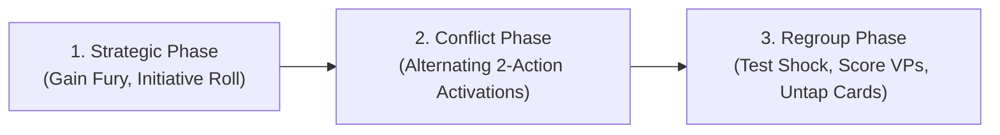

# PROJECT CODEX: IRON & WRATH — CORE RULES REFERENCE (2-PAGE TOURNAMENT STANDARD)

*A model-agnostic, hyper-tactical wargame engine. Zero corporate bloat. Zero downtime. Pure tabletop warfare.*

---

# [PAGE 1: SEQUENCE OF PLAY, ACTIVATIONS & THE 2-ACTION MENU]

## 1. GAME SCALE, ARMY CONSTRUCTION & BATTLEFIELD
* **Standard Army Size:** 1,000 Points (typically 5–8 unit cards, 15–30 models total).
* **Battlefield Dimensions:** 44" × 30" (Combat Patrol size) or 44" × 60" (Grand Skirmish).
* **Game Duration:** 4 Battle Rounds (approx. 45–60 minutes).
* **Army Construction Limits (The Anti-Deathstar Rules):**
  * *Single Unit Cap:* No single unit card may cost more than **350 points (35% of total force)**.
  * *Physical Slot Limits:* Max 2 Weapons and 1 Tactical Trait per unit card.
  * *Warlord Requirement:* Exactly 1 Hero or Leader model must be designated as your army Warlord.
  * *Fireteam Linking:* Cheap Conscript/Thrall units deploy and activate in linked pairs/trios on a shared card to prevent activation spam.
* **Victory Conditions:** Primary Objectives (scored at the end of each Round: 5 VPs per held objective) + 1 Secondary Objective selected prior to deployment (10 VPs max).

---

## 2. SEQUENCE OF PLAY
Each Battle Round consists of three chronological phases:



### PHASE 1: STRATEGIC PHASE
1. **Command Refresh:** Both players gain **3 Base Fury** + **1 Bonus Fury** for each Objective held at the start of the round.
2. **Aggression Initiative:** Both players roll 1d6. The player who had more models in the opponent's deployment half at the end of the previous round gains **+1 to their roll**. Higher roll chooses who activates first. Ties reroll.

### PHASE 2: CONFLICT PHASE (ALTERNATING CARD ACTIVATIONS)
* Players take turns activating **ONE unit card** at a time.
* When a unit is selected, perform its **2 Actions** from the Action Menu.
* **The Anti-Double-Tap Rule:** The last unit activated at the end of a round cannot be selected as the very first unit to activate in the next round.
* **Card-Tap Protocol:** Once the unit completes its 2 actions, rotate its physical Unit Card 90° (Tapped / Exhausted). It cannot activate again this round unless targeted by a specific reaction card.
* When both players have exhausted all unit cards, proceed to Phase 3.

### PHASE 3: REGROUP PHASE
1. **Suppression Recovery:** All units suffering from `[RATTLED]` automatically clear the condition. Units that are `[PINNED DOWN]` downgrade to `[RATTLED]`.
2. **Score Objectives:** Award Victory Points for controlled objectives (controlling player has more base Class value within 3" of the marker than opponent).
3. **Card Refresh:** Rotate all exhausted unit cards back to upright (0°). Round advances.

---

## 3. THE 2-ACTION MENU
During a unit’s activation, it receives **2 Action Points (AP)** to spend from the following list. You may select the same action twice only if labeled `(Repeatable)`.

| Action Name | Cost | Tactical Effect & Restrictions |
| :--- | :---: | :--- |
| **ADVANCE** | 1 AP | Move up to the unit's **Movement (`MOV`)** stat in inches. May not move within 1" of enemy models. *(Repeatable)* |
| **RUSH** | 1 AP | Move an additional **1d6"** (or flat **+3"** if on open road/ground). Unit cannot shoot this activation. |
| **AIMED FIRE** | 1 AP | Fire ranged weapons using **Ranged Skill (`RS`)**. If the unit did not move this activation, gain **+1 to Hit**. |
| **SNAP FIRE** | 1 AP | Fire ranged weapons after Advancing. Suffer **-1 to Hit** (Heavy weapons cannot Snap Fire). |
| **CHARGE** | 1 AP | Target an enemy unit within `MOV + 2d6"`. Must finish in base-to-base contact. If successful, gain `[CRASHING]` (+1 to Wound rolls) and strike first. |
| **BRUTAL MELEE**| 1 AP | Engage in close combat with enemy models within 1" engagement range. Roll melee attacks using **Melee Skill (`MS`)**. *(Repeatable)* |
| **HUNKER DOWN** | 1 AP | Unit drops prone behind cover. Gains **+1 to Saves** (subject to the 3+ Save Cap) and `[STEALTH]` (-1 to be hit) until next activation. |
| **RALLY** | 1 AP | Unit regroups. Immediately clears `[RATTLED]`, or downgrades `[PINNED DOWN]` to `[RATTLED]`, and restores 1 lost `Might`. |

---

## 4. MOVEMENT & LINE OF SIGHT RULES
* **True Line of Sight:** A model has Line of Sight if a straight, uninterrupted line can be drawn from any part of the firing model's torso/head/hull to any part of the target model's main body (ignoring banners, gun barrels, and antennae).
* **Base Clearance:** Models may freely move through friendly models but cannot finish their move overlapping any base.
* **Difficult Ground:** Woods, rubble, and steep slopes reduce movement by **-2"**.
* **Coherency:** Models in a squad must remain within **2" horizontally and 5" vertically** of at least one other model in the squad.

---

# [PAGE 2: COMBAT RESOLUTION, THE 5 ANTI-FRUSTRATION RULES & TERRAIN]

## 5. THREE-STEP COMBAT RESOLUTION (FLAT WOUND ARCHITECTURE)

The engine preserves the thrilling tactile rhythm of 3-step combat, but replaces clunky Strength vs. Toughness charts with **flat, self-contained Weapon Wound Rates**:

```
[STEP 1: TO-HIT]        Roll 1d6 >= Attacker's Ranged Skill (RS) or Melee Skill (MS).
[STEP 2: TO-WOUND]      Roll 1d6 >= Weapon's Inherent Wound Rate (2+, 3+, 4+, or 5+).
[STEP 3: SAVE ROLL]     Defender rolls 1d6 >= Target Save (SAVE) modified by Weapon Pen.
```
*Each failed Save roll deducts the weapon's Damage (DMG) characteristic from the target model's **Might**. Unblockable attacks inflict **Fatal Wounds**, bypassing Save rolls entirely (preventable only by `[WARD]` or `[UNYIELDING]`).*

### WEAPON WOUND TIERS
* **2+ (Devastating Overmatch):** Anti-armor railguns, pneumatic siege-fists, thunder hammers.
* **3+ (Superior Kinetic Power):** Heavy rotary cannons, relic power blades, brute greataxes.
* **4+ (Military Parity):** Standard battle-rifles, bolters, combat shotguns, chain-swords.
* **5+ (Light / Scrap Munitions):** Flimsy shrapnel-pistols, rusty shivs, swarming claws.

### HOW BEHEMOTHS & TANKS SURVIVE (TARGET RESILIENCE)
Without needing a separate Toughness stat, heavy monsters and vehicles survive through:
1. **High Base Save (SAVE 3+):** Small arms with Pen 0 or Pen -1 bounce off 70–85% of the time.
2. **Deep Might Pools:** Line infantry have 1–2 Might; Behemoths and Tanks have **12–16+ Might**.
3. **The `[ARMORED HULL]` Trait:** Class 4 & 5 Behemoths ignore Pen 0 small-arms fire and subtract -1 from incoming enemy Wound rolls.
4. **Anti-Keywords:** Dedicated anti-tank cannons carry `[ANTI-VEHICLE 2+]` or `[ANTI-BEHEMOTH 2+]`, naturally tearing through hulls.

---

## 6. THE 5 CORE ANTI-FRUSTRATION RULES

### RULE 1: THE 3+ SAVE CAP
* **No save may ever be modified better than 3+ on 1d6.**
* Cover, shields, and defensive traits can stack to offset incoming Pen, but the final required roll to prevent damage can **NEVER be 2+**. A natural roll of 1 or 2 always fails. Invulnerable Deathstars are mathematically impossible.

### RULE 2: THE KINETIC SUPPRESSION ENGINE (RATTLED & PINNED DOWN)
* **Tier 1: `[RATTLED]`:** Inflicted whenever an attack scores **2 or more Hits** (even if saved) OR causes unsaved damage. The unit suffers **-2" Movement** and **-1 to all Hit rolls**. (Spend 1 Fury on activation or 1 AP Rally to clear).
* **Tier 2: `[PINNED DOWN]` (Super-Shock):** Inflicted if an already `[RATTLED]` unit is hit again by 2+ hits, OR when damaged by weapons with `[FATAL WOUNDS]`, `[SHRAPNEL]`, or `[REAPING]`.
  * *Class 1 & 2 (Infantry/Elites):* **IMMOBILIZED!** Movement reduced to 0". Cannot Advance, Rush, or Charge.
  * *Class 3, 4 & 5 (Monsters/Tanks):* -4" Movement and -1 Attack Die.
  * *Clearing Pin:* Spend 1 AP Rally to downgrade to `[RATTLED]`, or spend 2 Fury to break the pin instantly.

### RULE 3: DEATH RATTLE (ANTI-ALPHA STRIKE)
* When a model is slain by an enemy attack **before it has had an opportunity to activate this round**, it does NOT immediately leave the table.
* The dying model receives one **Death Rattle Action**: It may immediately make **ONE single melee strike or ONE single snap-fire shot** against its killer before being removed from play. Centerpiece models are never removed without fighting.

### RULE 4: CARD TAPPING (ZERO TOKEN CLUTTER)
* No wound counters, activation tokens, or glass beads needed on the tabletop.
* Track squad health on the dry-erase or sleeved Unit Card. Rotate the card 90° when finished. If a card is upright, it is active. If tapped, it has acted.

### RULE 5: AGGRESSION-FUELED FURY POOL
* Fury points are gained by **advancing, charging, and capturing ground**. Camping in your deployment zone generates zero bonus Fury. Fury fuels the 10-card Reaction Deck.

---

## 7. UNIVERSAL TERRAIN KEYWORDS
* **LIGHT COVER (Fences, Barrels, Bushes):** Grants `[LIGHT COVER]`. Target models gain **+1 to Saves** against ranged attacks made from more than 6" away (subject to the 3+ Save Cap).
* **HEAVY COVER (Ruined Stone Walls, Bunkers, Obsidian Ruins):** Grants `[HEAVY COVER]`. Ranged attacks suffer **-1 to Hit**, and defender gains **+1 to Saves** (subject to the 3+ Save Cap). Negates `[SHRAPNEL]`.
* **HAZARDOUS GROUND (Acid Pools, Magma Vents, Razor Wire):** Any unit moving through tests 1d6 per model. On a natural 1, that model suffers 1 Fatal Wound.
* **OBSCURING (Structures taller than 4"):** Blocks Line of Sight completely across the footprint unless a model is inside the structure. Ground floor up to 3" is treated as 100% solid.

---

## 8. THE 10-CARD TACTICAL REACTION DECK
Both players hold an identical 10-card deck. **Limit:** Maximum 1 Reaction Card per player per activation. Costs paid from your Fury Pool.

| Reaction Card | Fury Cost | Trigger Window | Tactical Effect |
| :--- | :---: | :--- | :--- |
| **Command Reroll** | 1 | Any dice roll you make | Reroll any single d6 roll (Hit, Wound, Save, Hazard, or Distance). |
| **Defensive Overwatch** | 1 | Enemy moves or charges within 12" | Target unactivated friendly unit fires Snap Fire (hits on unmodified 6s; `[SCORCH]` autohits). |
| **Smoke Screen** | 1 | Target friendly unit is declared as ranged target | Target unit and allies within 3" gain Cover (-1 to be hit, cancels 1 Pen) until end of activation. |
| **Counter-Charge** | 2 | Enemy completes charge within 6" of friendly unit | Unengaged friendly unit makes an immediate 6" Counter-Charge into combat. |
| **Melee Riposte** | 2 | Enemy unit finishes melee attacks | Interrupt! Target engaged friendly unit strikes next with `[STRIKE FIRST]` before other enemies. |
| **Honor Duel** | 1 | Champion/Hero attacks in melee | Champion's melee attacks gain `[PRECISION]` to allocate damage directly into the enemy Leader. |
| **Frag Grenade** | 1 | Friendly infantry unit activates within 8" of enemy | Roll 6d6 at target enemy: each 4+ inflicts 1 Fatal Wound (ignores cover). |
| **Ramming Momentum** | 1 | Class 3/4 Behemoth finishes a Charge | Roll d6s equal to remaining Might: each 5+ deals 1 Fatal Wound (max 5); 1s deal 1 damage to charger. |
| **Flanking Ambush** | 2 | End of opponent activation (Round 2+) | Deploy 1 Reserve unit within 6" of any table edge and >8" from enemies. |
| **Iron Will** | 1 | Friendly unit becomes Rattled/Pinned (Once/battle) | Automatically clear suppression; unit is immune to Rattled/Pinned for the rest of the round. |
