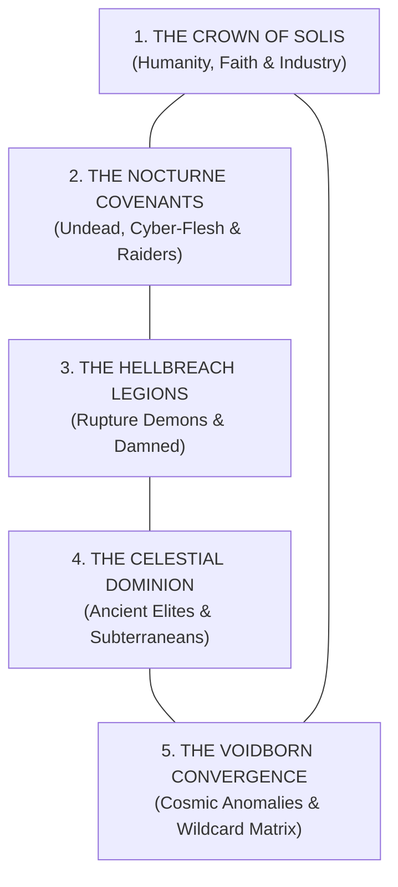

# THE SHATTERED DOMINION: WORLD LORE PRIMER & FACTION CODEX

*A world broken by celestial wrath. An age of unyielding iron, spilled blood, and ancient dread.*

---

## 1. THE GENESIS: THE GREAT SHATTERING

Centuries ago, the world was shielded by the **Aegis-Sphere**—a colossal, orbital lattice of brass, solar engines, and harmonic wards forged by an ancient progenitor civilization. Under its golden light, colossal continental cities prospered for millennia.

Then came **The Eclipse of Wrath**.

A cosmic cataclysm pierced the upper atmosphere, shattering the Aegis-Sphere into trillions of burning shards that rained down like apocalyptic artillery across the globe. Tectonic plates fractured. Volcanic veins burst open, flooding entire valleys with liquid slag. Deep abyssal rifts tore through the crust, venting primal nether-energies and eldritch anomalies.

The old civilizations perished in fire. From the ash arose survivors forged in cruelty, faith, and heavy iron. There are no safe harbors. There is no diplomacy. Only the perpetual clash of five dominant warlord civilizations vying for absolute dominion over the remnants of the broken world.

---

## 2. AESTHETIC & THEMATIC PILLARS

```
[VISUAL DNA]
Berserk (Brutal Dark Fantasy) + Doom (Cyber-Demonic Aggression) +
Conan (Savage Muscular Vitality) + Rogue Trader (Industrial Gothic Grimdark)
```

* **Heavy Metal Grimdark:** Unapologetic, muscular, and visceral. Hulking plate-armored champions, smoke-belching diesel-engines, roaring rotary cannons, and blood-soaked greatswords.
* **No Preachy Modernity:** No sanitized corporate HR language, no preachy moralizing, no fourth-wall-breaking disclaimers. The setting takes itself dead seriously as a brutal, mythical theater of war.
* **Open-World Diversity:** This is not a single muddy chasm. The battlefield spans towering neo-gothic cathedral spires, volcanic basalt plains, rusted machine-forges the size of mountains, cyclopean bone-necropoli, and primeval wilderness prowled by apex horrors.

---

## 3. THE FIVE GRAND ALLIANCES (4192 AD)



---

### GRAND ALLIANCE 1: THE CROWN OF SOLIS
* **Realm:** *The High Solar Citadels & Trench Fronts* — Colossal cliffside bastions, continent-spanning trench lines, and deep-ocean tectonic sinkholes.
* **Philosophy:** Uncompromising solar orthodoxy, human survival at all costs, and industrial mass production.
* **Member Factions:**
  1. **The Auric Solar-Host:** Golden oligarchs powered by lobotomized debt-thralls wired into their armor.
  2. **The Golgotha Trench-Legions:** Faceless millions in gas masks, mud greatcoats, and rolling artillery.
  3. **The Sun-Pyre Witch-Courts:** Spiked-crown inquisitors and cage-bound burning saints wielding holy flamers.
  4. **The Aegis Knight-Houses:** Feudal high-nobility on mechanical steam-steeds and gothic knight-walkers.
  5. **The Abyssal Bathys-Corps:** Crushing brass diving suits, diving-bell crawlers, and brine-fog harpooners emerging from tectonic trenches.

---

### GRAND ALLIANCE 2: THE NOCTURNE COVENANTS
* **Realm:** *The Shadow-Vats & Tundra Reaches* — Ancient gothic keeps, flesh-grafting workshops, frozen northern fjords, and lawless corsair ports.
* **Philosophy:** Cursed blood, perpetual rebirth through cybernetic and necrotic surgery, and the freedom of the raid.
* **Member Factions:**
  6. **The Sanguine Aristocracy:** Baroque vampire duelists on skeletal nightmares draining life-force.
  7. **The Mordant Ghoul-Courts:** Cannibal ghouls gripped by royal courtly delusions, regenerating wounds mid-charge.
  8. **The Prometheus Flesh-Guilds:** Heavy-metal machine-priests and chirurgeons grafting gears, data-spikes, and stolen organs into living brutes.
  9. **The Frost-Skaer Blood-Raiders:** Runic frost-barbarians, blizzard shamans, and armored war-mammoths.
  10. **The Dread-Fleet Buccaneers:** Tri-elemental sky, sea, and land pirates piloting armored skiff-galleons with swivel broadsides.

---

### GRAND ALLIANCE 3: THE HELLBREACH LEGIONS
* **Realm:** *The Nether-Rifts & Cinder Basins* — Massive tectonic fractures venting boiling blood, warp-fire, sulfur smoke, and demonic geometries.
* **Philosophy:** Might is the only law. Blood, rot, siegecraft, and sonic excess tear open reality.
* **Member Factions:**
  11. **The Cinder-Gorged Legion:** Brass-armored, kill-or-die blood demons with zero shooting, surging forward when fired upon.
  12. **The Black-Bile Congregation:** Bloated plague-knights and censer-bearers radiating an aura of armor-rotting contagion.
  13. **The Moloch Iron-Forged:** Hazard-striped siege-masters who sacrifice infantry to feed furnace-bellied walking artillery.
  14. **The Cabal of the Inverted Star:** Floating sorcerers bending non-Euclidean geometry, swapping positions, and redirecting bullets.
  15. **The Velvet-Scourge Syndicate:** Hedonistic acoustic duelists moving at terrifying speed, addicted to sonic blasters and pain.

---

### GRAND ALLIANCE 4: THE CELESTIAL DOMINION
* **Realm:** *The Star-Pyramids & Subterranean Depths* — Ancient orbital ruins, prehistoric primal jungles, volcanic obsidian vaults, and irradiated under-hive warrens.
* **Philosophy:** Cosmic prophecy, unyielding grudge-memory, and survival in the planet's darkest depths.
* **Member Factions:**
  16. **The Starfire High-Court:** Angelic starlight elves with plasma-glaives, high-mobility flight, and post-melee sidesteps.
  17. **The Sun-Scaled Temple-Host:** Cold-blooded saurian warriors and laser-bearing carnosaur behemoths fulfilling cosmic prophecy.
  18. **The Obsidian Forge-Tombs:** Ancestral dwarven kings encased in volcanic obsidian and molten gold, reassembling after death.
  19. **The Skitter-Kin & Rad-Scavengers:** Ratmen and mutated dregs in taped hazmat suits with jury-rigged plasma cutters and unstable overcharged doom-tech.
  20. **The Astral Shadow-Clans:** Dark-tech cyber-ronin and webway raiders generating Pain Tokens to take 3 actions per activation.

---

### GRAND ALLIANCE 5: THE VOIDBORN CONVERGENCE
* **Realm:** *The Cosmic Anomalies & Scrap-Wastes* — Dimensional tears flickering with purple-and-gold nether-energy, devouring bio-swarms, and desert speed-strips.
* **Philosophy:** Dimensional displacement, ruthless adaptation, and total miniature freedom.
* **Member Factions:**
  21. **The Rift-Stalker Menagerie:** The universal proxy wildcard, allowing any miniature collection or 3D print to fight using modular mercenary contracts.
  22. **The Radiant Concordat:** Porcelain-armored railgun marksmen who sacrifice blood for precision, shielded by towering Gilded Gore-Brutes (Ogres).
  23. **The Apex Bio-Swarm:** Insatiable extra-galactic bio-monsters mutating adaptations (scythes, armor, or speed) mid-battle.
  24. **The Diesel-Skull War-Horde:** Green-and-ash-skinned speed-freaks riding supercharged scrap-buggies with point-blank hailfire dakka.
  25. **The Eclipse Shadow-Fiends:** The ONE and ONLY true phantom army—untouchable outside 12", phasing through solid walls and terrain.

